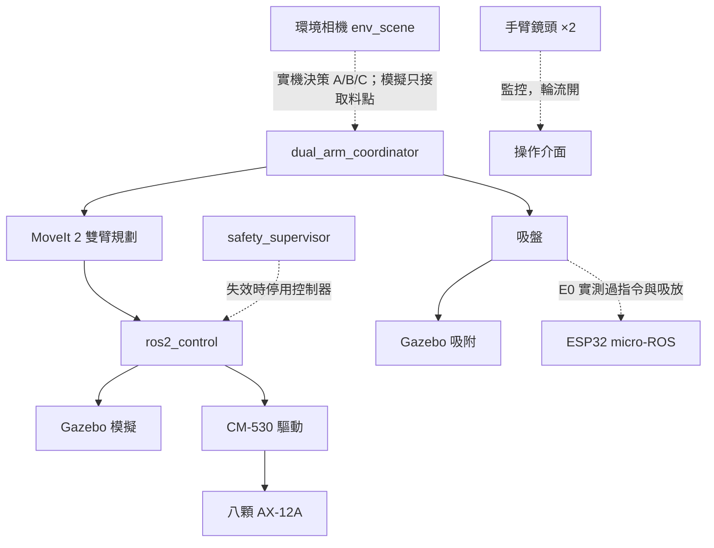

# 雙機械手臂協作系統

兩支 PhantomX Pincher 手臂協作，用吸盤把瓶蓋從 A 區經 B 區交接，放到 C 區八個格位。整合了 ROS 2 Jazzy、MoveIt 2、Gazebo Harmonic、三相機 OpenCV，實機由一片 CM-530 控制八顆 AX-12A。


*Gazebo 模擬：Arm 2 在 B 區交接位置吸取瓶蓋，此時 Arm 1 已退回 HOME。*

## 從這裡開始

| 我想要 | 看這裡 |
|---|---|
| **在 Windows 或 Jetson Orin 上安裝和執行** | [安裝與使用指南](dual_arm_ws/README.md) |
| 了解目前進度和還缺什麼 | [PROGRESS.md](dual_arm_ws/docs/PROGRESS.md) |
| 查看測試結果 | [TEST_REPORT.md](dual_arm_ws/docs/TEST_REPORT.md) |
| 接手開發，或讓 AI 助手協助 | [AGENTS.md](dual_arm_ws/AGENTS.md) |
| 工作包、衝突清單、待決定事項 | [MODIFICATION_PLAN.md](dual_arm_ws/docs/MODIFICATION_PLAN.md) |
| 用操作介面啟動模擬與搬運 | [安裝與使用指南第 5 節](dual_arm_ws/README.md)、[UI_PLAN.md](dual_arm_ws/docs/UI_PLAN.md) |
| **到現場測試實機** | [實機測試手冊](dual_arm_ws/docs/HARDWARE_TEST_GUIDE.md) |
| 測試計畫與放行階梯 | [TEST_PLAN.md](dual_arm_ws/docs/TEST_PLAN.md) |
| Orin 部署與實機步驟 | [ORIN_DEPLOYMENT.md](dual_arm_ws/docs/ORIN_DEPLOYMENT.md) |
| 中斷後續接 | [RESUME.md](dual_arm_ws/docs/RESUME.md) |
| 換到另一台電腦時給 AI 的 prompt | [HANDOFF_PROMPT_NEXT_COMPUTER.md](dual_arm_ws/docs/HANDOFF_PROMPT_NEXT_COMPUTER.md) |
| HOME 姿態與馬達數值換算 | [HOME_POSES.md](dual_arm_ws/docs/HOME_POSES.md) |
| CAD 檔案與限制 | [cad/README.md](dual_arm_ws/cad/README.md) |

最快的開始方式（完整步驟見[安裝與使用指南](dual_arm_ws/README.md)）：

```bash
git clone --recurse-submodules https://github.com/xian1022/dual_arm_system.git
```

## 目前狀態

| 功能 | 狀態 |
|---|---|
| 建置專案、Gazebo 模擬、RViz | ✅ 可用 |
| 兩物體 A→B→C 搬運（coordinator） | ✅ 模擬可用，含故障停止與人工復歸；區域與格位判斷用 Gazebo 真實座標 |
| CM-530 驅動、軟體安全監控 | 🟡 只測過 Mock Serial 與 MoveIt mock，還沒接實機 |
| 八物體完整搬運 | ❌ 未完成，目前模型只搆得到 4 個瓶蓋、7 個 C 格 |
| 視覺自動定位 | 🟡 模擬中取料點可由視覺決定。實機改由環境相機（env_scene）判斷 A/B/C，手臂鏡頭只監控並輪流開；程式已完成，env_scene 用上游 6b3d5c1（2026-11-13 現場尺量的 C 格位置），等 Orin 驗證；2026-11-13 起操作介面顯示 env_scene 的框線影像 |
| ESP32 吸盤 | 🟡 2026-11-13 E0 在 Orin 實測：重燒韌體（腳位 12/13/25/26），指令 1、2 是 arm1、3、4 是 arm2，約 1 秒吸穩；斷電後要重開 agent 才會重連；還沒在搬運流程中使用，見 [E0 紀錄](dual_arm_ws/docs/evidence/hardware/20261113_E0/record.md) |
| 操作介面 | 🟡 模擬中可啟停系統、開始、取消、強制停止、回 HOME、復歸；嚴格實機模式只接通強制停止，尚未在 Orin 開過 |
| 實機 Prototype | 🟡 2026-11-13 新增：用估計校正讓實機跑完整流程（不要求精準），介面選「實機 Prototype」或 `hardware_prototype.launch.py`；只測過 Mock Serial，結果不算校正證據，見 [實機測試手冊](dual_arm_ws/docs/HARDWARE_TEST_GUIDE.md#prototype-模式) |
| Orin 部署 | 🟡 2026-11-10 已在 Orin 安裝、建置並通過離線測試與 Mock；唯讀連線 PASS，手動方向確認只做完 Arm 1 |
| 實機校正 | ❌ 未完成，需要現場量測 |

**實機控制預設關閉**，必須完成實測校正才能開啟。任務節點目前也會拒絕以實機模式啟動。

## 工作區配置

> 2026-11-10 實機量測（arm1）：手臂在遠離使用者側，A 區在手臂自身右方，使用者由左至右看到 A | B | C，模擬已改成這個配置，定義見 [COORDINATE_FRAMES.md](dual_arm_ws/docs/COORDINATE_FRAMES.md)。2026-11-11 現場量到板寬、軸心位置與格位編號，模擬已依此更新（階段 C）；下方截圖在新配置重新擷取（2026-11-12，`run_checks.sh t2`，[phase_c_20261111](dual_arm_ws/docs/evidence/phase_c_20261111/README.md)）。


| 區域（使用者看過去） | 用途 | 負責手臂 |
|---|---|---|
| **A 區**（左） | 瓶蓋起始位置 | Arm 1 取物 |
| **B 區**（中） | 交接區，同一時間只有一支手臂能進入 | Arm 1 放下、Arm 2 取走 |
| **C 區**（右） | 八個白色放置格 | Arm 2 放置 |

兩支手臂在遠離使用者的長邊，面向使用者：Arm 1 的旋轉軸在 A/B 分界，Arm 2 在 B/C 分界。

泡棉板實測 600 × 240 mm（2026-11-11），三區各 200 × 240 mm，旋轉軸在靠手臂的長邊外約 5 mm，模擬已改成這些實測值。C 區格位依實物編號：1、2 最靠手臂，單號在靠 B 區的那一欄。

## 搬運流程


這是目前 `dual_arm_coordinator` 的流程，一次只讓一支手臂動作。

| 1. HOME 預備 | 2. Arm 1 在 A 區取物 |
|:---:|:---:|
|  |  |
| **3. Arm 1 放到 B 區** | **4. Arm 2 在 B 區吸取** |
|  |  |
| **5. Arm 2 搬到 C 區** | **6. 兩物體放置完成，兩臂回 HOME** |
|  |  |

## 系統架構



## 三相機畫面

| 環境相機 | Arm 1 相機（看 A 區） | Arm 2 相機（看 C 區） |
|:---:|:---:|:---:|
|  |  |  |

目前模擬中的相機固定在空間中，實機的手臂相機則裝在手臂末端。三顆實體相機都還沒校正；模擬中的相機有依已知幾何產生的校正，不能用在實機。

## 操作介面


*2026-11-11 在 Gazebo 模擬中實際擷取：Arm 1 持物下降到 B 區，B 區互鎖由 Arm 1 佔用，Arm 2 禁止進入。*

用 `ros2 run dual_arm_hmi hmi` 開啟，可以啟動與關閉模擬、開始工作、取消、強制停止、解除鎖定、回 HOME、復歸；實機模式目前只接通強制停止。用法見[安裝與使用指南第 5 節](dual_arm_ws/README.md)，規格見 [UI_PLAN.md](dual_arm_ws/docs/UI_PLAN.md)。畫面說明：模擬相機在介面使用的 `~/.ros/dual_arm_calib/sim` 沒有產生校正，三格都標「校正 FAIL」；區域狀態只是視覺參考，任務決策用 Gazebo 真值（右上「決策來源」）。環境相機在目前配置開機時找不到場地，顯示 `ZONES MISSING`。C 區格位圖用的是模擬的編號，和實物差 180°，階段 C 一起改。事件紀錄的故障會置頂。

## 模擬與實機

| Gazebo 模型 | 實機 |
|:---:|:---:|
|  |  |

模型由 SolidWorks CAD 轉換而來。A 區方向與 Arm 1 的 j1 方向已和實機一致；板寬、軸心到板緣距離與格位已依 2026-11-11 實測修正，Arm 2 的 j1 方向也已確認；各軸零點還沒校正（要等 H2）。模擬成功不代表實機可以直接執行。

---

*畫面擷取自 2026-11-12 的 coordinator 兩物體搬運模擬，從空的 C 區開始，放到格位 1、2。模型或流程改變後，用 `scripts/capture_readme_images.py` 重新擷取。*
